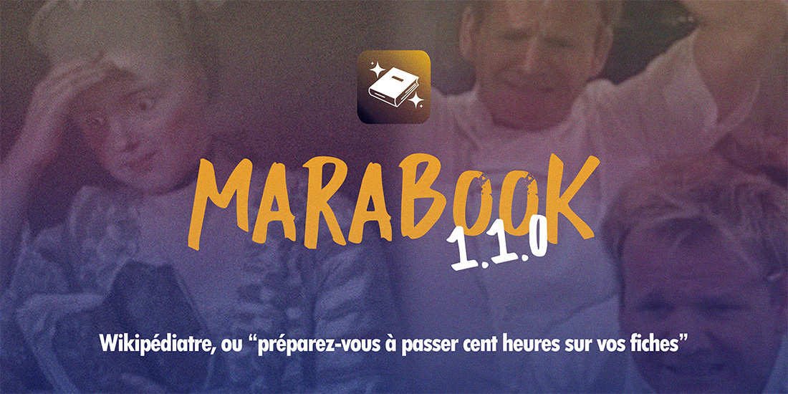

## 1.1.0 - "Wikipédiatre" (01/11/2026)

### Fonctionnalités majeures

#### 🍵 Mental-O
Arrivée du **premier DLC de Marabook**, Mental-O, pour vos cartes mentales, téléchargeable depuis l'écran d'accueil ou depuis Préférences > DLC ! Plus d'explications plus bas !

#### 😱 FPDM (ou "Fiches de personnages pour dangereux monomaniaques")
Arrivée du **second DLC de Marabook**, les FPDM ! Depuis vos fiches de perso, vous pourrez créer un nouvel onglet FPDM où de nombreuses questions vous attendent... j'espère que vous connaissez bien vos persos ! Le résultat de ces questions n'apparaît pas dans les fiches wiki pour l'instant.

#### 🌍 L'encyclopédie HTML
Depuis Fichier > Export, vous pouvez désormais exporter l'entièreté de vos fiches et de votre lexique dans un ensemble de pages HTML très classiques afin de les partager même à ceux qui n'ont pas l'appli ! Bien des options de customisation s'offrent à vous, et ce n'est que le début... 

#### 🕺 Les profils Marabook
A votre première ouverture (ou si rien n'est défini), l'app vous demandera de **choisir un profil d'utilisation** qui affichera ou masquera des fonctionnalités dont vous n'auriez pas besoin. Le choix sera entre Ecrivain.e, Editeur.ice, Cinglé.e et Moi-même (personnalisé). Pour note : l'app telle que vous la connaissiez jusque là suit le profil Cinglé.e - c'est l'expérience de base, avec toutes les fonctionnalités affichées.

Vous pourrez changer ce profil dans Préférences > Profil au besoin.

N'hésitez pas à faire des retours sur le contenu de chaque profil - ils peuvent être réajustés !

#### 🍼 Le tutoriel
Un tuto peut être lancé depuis plusieurs endroits dans l'application, et un tuto complet peut être lancé depuis l'écran d'accueil ! Découvrez les grandes lignes de Marabook une par une, et *arrêtez de venir me demander des trucs qui existent déjà !*

#### 🔗 Le GG (Gros Graph)
Dans Encyclopédie, vous aurez désormais accès au Gros Graph, une visualisation par noeuds de toutes vos fiches et écrits et des liens que vous avez tissé entre eux tous !

De plus, l'onglet Présence vous permettra de voir qui est présent où, à quelle fréquence, et de vérifier que vous n'avez pas oublié un personnage en route...

#### 🌳 L'éditeur de relations
Depuis Editer > Fiches, vous pouvez désormais voir les Relations entre perosnnages disponibles et créer de nouveaux types de relations (Arrière grand..., arrière petit..., cousin éloigné...) dans le tout nouvel **éditeur de relations** !

Vous pourrez créer de nouveaux liens qui seront ensuite utilisables dans vos fiches disposant de l'option "Relations".

Vous pouvez aussi retrouver l'éditeur depuis un bouton dédié dans la section Relations de vos fiches de personnage.

**NOTE**: modifier les relations déjà existantes ne *changera pas* vos fiches déjà faites ! Il vous faudra supprimer la relation et la réassigner ! C'est fait pour ne créer aucun bug si vous faites n'importe quoi ou avez déjà des fiches finies.

#### 📚 Les onglets
Ajout des **Onglets** pour avoir encore plus de choses ouvertes à la fois ! Créez-en avec CTRL+T et fermez-en avec CTRL+W. Vous pouvez activer ou désactiver les onglets, en plus de paramétrer leur nombre maximal, dans Préférences > Général. Cliquer sur un élément de la pile avec la molette de la souris l'ouvrira aussi dans un nouvel onglet !

---

### Fonctionnalités mineures

#### Textes
* Ajout d'un **sélecteur de format** à la création d'un livre, et de meilleures options d'ergonomie de l'éditeur de texte lorsqu'on se trouve dans un livre.
* Ajout des **Objectifs de texte** et des **Limites de texte**, pour voir en temps réel où vous en êtes sur un texte limité prédéfini. Cliquez sur la tuile d'un texte pour paramétrer tout ça !
* Refonte de l'ordre des onglets du ruban et ajout de l'option d'afficher/cacher les marqueurs de veuve/orpheline.
* Refonte de l'interface de correction, ajout de raccourcis pour les nouvelles entrées du dictionnaire.
#### Fiches
* Ajout des **tags** de fiches, pour les retrouver par mots-clés.
* Réorganisation des filtres et ajout du filtre par tag.
* Les tuiles des fiches peuvent être glissées/déposées dans des sous-catégories.
* Ajout des aperçus en mode wiki, lorsque vous survolez les liens (Ctrl+K) pointant vers d'autres fiches.
* Ajout de champs sur les fiches (date de décès).
* Ajout des raccourcis fiches `F1` (mode wiki) et `F2` (généalogie).
#### Divers
* Ajout de sons à la sauvegarde, à l'erreur et au dévérouillage de succès. Désactivables depuis les préférences.
* Ajout des catégories de la pile
* Ajout d'une barre de recherche de fichier en raccourci avec `CTRL+,`
* Renforcement de la logique de sauvegarde pour créer des fichiers horodatés et encore plus se prémunir face aux ruptures d'anévrisme potentielles de l'app !

---

### Correctifs
* Correctif des limites d'animation pour les tuiles.
* Correctif d'interface dans tous les panneaux.
* Correctif sanitaire sur la suppression de catégories de fiches et des fiches manquantes.
* Bugfix de crash dans le catalogue des polices.
* Correctif d'interface des styles de paragraphe globaux des préférences.
* Correctif des types de styles de paragraphe (affichage de puces selon l'amplitude).
* Correctif de détection de noms propres post-particules possessives.
* Reformulation ou suppression de nombreuses infobulles.
* Correctif de l'écran des caractères spéciaux de l'éditeur.
* Réorganisation des menus système (fichier, édition, format...)

---

## Mental-O 1.0.0

Ce premier DLC de Marabook est également une application solo que vous pourrez retrouver [ici](https://github.com/Pardaramskha/mental-o/releases/latest) !

Créez des cartes mentales simplement avec un système de lien intérieur, des notes, un tas d'options de formatage et une expérience grossièrement smooth as fuck.
Ca va pas casser trois pattes à un canard, mais ça fait le boulot ! 

Les quelques bails à retenir :
* Double clic pour créer une boite ou en modifier le contenu.
* Quatre modes pour gérer au détail les liens, les boites, etc.
* CTRL+G = grouper des boites ensemble.
* Espace + Clic / Clic molette = Naviguer
* Servez vous de Préférences > Raccourcis (dans Marabook : Préférences > Mental-O (dlc)) pour simplement afficher et retenir les raccourcis efficaces ! Vous pouvez aussi les épingler au Tust, qui s'affiche sur votre carte !
